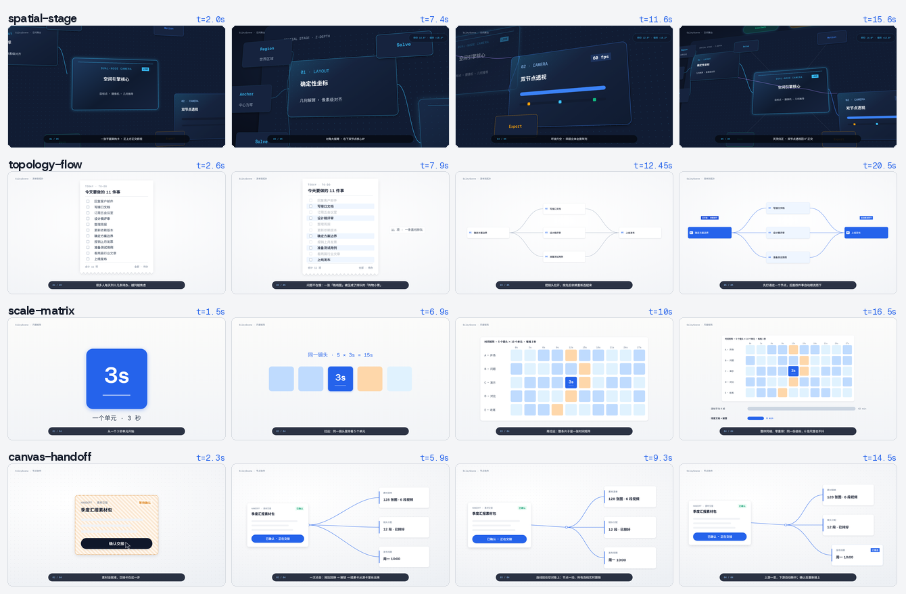

# SilkyScene

**Canvas-first scene layout with a deterministic motion engine.** Lay out a 16:9 canvas once, animate it with keyframes, eases and a two-node camera — then either **present it live, step by step, in the browser** or **export it frame-exact to MP4**. Same files, same pixels.

以画布为先的 Web 场景引擎（`silkyscene@1`）：先解算确定几何，再交给确定性的运动引擎。

> **双模合一 = 现场步进演示 `present.html` + 确定性视频导出 `player.html` / `export:mp4`。**
> 现场演示时按 `→` 一页页讲；会后一行命令导出 MP4。两者都只调用 `prepared.renderAt(t)`，逐帧一致。



| 官方样片 | 看点 |
| --- | --- |
| `spatial-stage` | 暗色 3D 空间舞台：四层 Z 轴景深甲板、双节点透视相机俯冲 / 侧倾 / 环绕，最后归正回 0° |
| `topology-flow` | 清单到拓扑：双节点透视推镜、曲线连线、1→3→1 依赖图 |
| `scale-matrix` | 微距到尺度矩阵：对数 zoom 大跨度拉远、组整体缩放、HUD 联动 |
| `canvas-handoff` | 跨层微交互：光标弧线、按压回弹、空对象驱动连线生长 |

## 快速开始

```bash
npm install
npm run build                    # 输出 dist/
npm run dev                      # Vite：http://127.0.0.1:5311/playground/inspector.html
```

| 页面 | 地址 |
| --- | --- |
| 检查器 | `http://127.0.0.1:5311/playground/inspector.html?doc=spatial-stage` |
| 现场演示 | `http://127.0.0.1:5311/playground/present.html?doc=spatial-stage`（`→` 下一步、`←` 平滑倒放、`F` 全屏、`H` 隐藏控制条、`1`–`9` 跳页） |
| 帧播放页 | `http://127.0.0.1:5311/playground/player.html?doc=topology-flow&t=12` |

```bash
node tools/check_scene.mjs --strict spatial-stage topology-flow scale-matrix canvas-handoff   # 硬校验：0 错误、0 警告
npm run export:mp4 -- topology-flow --duration 6                       # → _storage/exports/topology-flow.mp4（需 Chrome/Edge + ffmpeg）
npm test                                                               # 编译 + 全套单测
```

## 用构建器写场景

```js
import { createSceneBuilder, px } from "@silkysite/scene"

const b = createSceneBuilder({ background: "#FAFAF8" })
b.region("world", { x: 0, y: 0, width: 6, height: 3.4 })
b.group("card", { in: "world", w: 0.6, h: 0.3 }, { opacity: 0 })
b.rect("card-bg", { in: "card", w: "100%", h: "100%" }, { fill: "#FFFFFF", radius: px(16) })
b.text("card-title", { in: "card" }, "本周进展", { fontSize: px(44), weight: 700 })
b.cue("card-in", 0.3, "card", "opacity", 0.5, 1, { ease: "ease-out" })
b.cue("push", 1.0, "camera", "zoom", 1.2, 1.15, { ease: "ease-in-out", interpolation: "log" })
b.step("cover", 2.2, "本周进展")
const { scene, timing } = b.build()   // 严格校验；写成 playground/<name>.scene.json + <name>-timing.json
```

完整的「五分钟写一份现场汇报」见 [docs/05 §7](./docs/05-检查器-现场演示与场景构建.md#7-五分钟写一份现场汇报)。

## 坐标硬契约

- 画布中心 `(0, 0)`，+X 右，+Y 上；`1 u = 1080` 设计 px（默认 1920 × 1080）
- 百分比相对所属容器整轴，边缘 `±50%`；`anchor` / 连线端点 `at` 为框内中心坐标 `[-1, 1]`
- 区域、组、元素 ID 全局唯一；`parseProject` 严格校验，未文档化字段直接报错

## 能力速览

- **图元**：`rect`（圆角、阴影、描边、斜纹、CSS 渐变）、`text`（自动测量）、`group`（整体缩放 + 裁切）、`line`（直线 / 水平垂直贝塞尔、trim 生长、断开重连）、`path`、`image`、`dots`、`null` 空对象
- **层级**：`world` / `under` / `screen`（HUD 不随相机）+ 世界遮罩
- **运动**：自由元素默认弧线、框内元素 `bound` 只做直线平移；cubic-bezier / spring / steps 缓动；motionPath；颜色节点
- **相机**：2D 目标点 + 取景（弧线、延迟跟随、对数 zoom）；可选双节点透视（`target.*` + `position.*` + 可重叠的 `approach.*`）
- **演示**：timing.json `steps` 停靠点；`createDeckController` 步进控制器（1× 正放、精确停靠、过渡中连按先吸附再继续、同速平滑倒放）
- **校验**：逐帧解算越界、逐帧采样轨迹 lint、画面质量（屏幕字号 < 13 px、取景边缘裁切）
- **导出**：零新增依赖的 MP4 流式导出（原生 CDP + ffmpeg），兼容 HyperFrames 捕获协议

## 文档

- [AGENTS.md](./AGENTS.md)：给 AI 编码代理的硬性手册
- [docs/](./docs/README.md)：01 设计基线 · 02 渲染与图元 · 03 运动角色 · 04 相机 · 05 检查器 / 现场演示 / 构建器 · 06 视频导出

## 目录

| 路径 | 内容 |
| --- | --- |
| `src/` | 入口 `index.ts`；`pipeline/`（校验、测量、解算、时间轴、lint、质量）、`render/`、`builder.ts`、`presentation.ts` |
| `playground/` | 检查器、现场演示页、帧播放页、四支官方样片与生成脚本 `examples/` |
| `tools/` | `check_scene`、`export_mp4`、`lint_scene`、`migrate_scene_v0_to_v1` |
| `_storage/` | 本地产物（字体、导出、打包），除 README 外不入库 |

```bash
npm pack --pack-destination _storage   # 生成发行 .tgz
```

## License

MIT © 2026 Zion Rao
